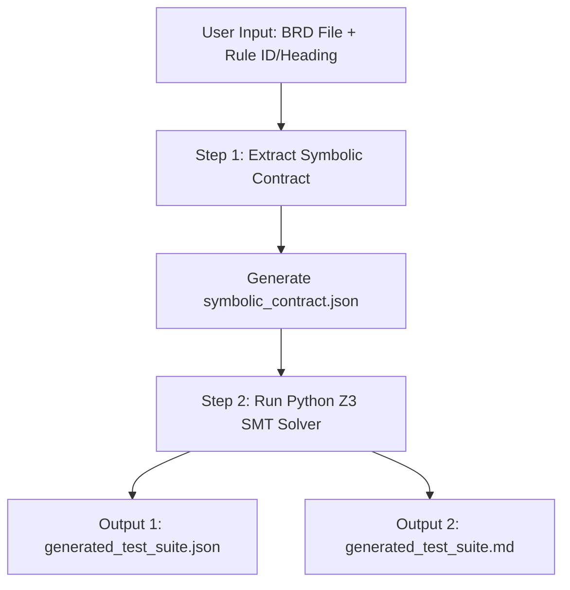

# COBOL Symbolic TestGen Orchestrator

## Overview

This master orchestrator automates the 2-step pipeline for targeted symbolic test data generation:
1. **Stage 1 (Contract Extraction):** Invokes `cobol-brd-to-symbolic-contract` to parse the specified rule from the BRD file and emit the `symbolic_contract_<rule_slug>.json` file.
2. **Stage 2 (SMT Solving & TestGen):** Runs the Python symbolic solver engine (`cobol_symbolic_testgen/src/main.py`) against the generated contract to produce concrete test inputs, expected outputs, status codes, and external middleware mocks.



---

## Inputs

1. **BRD Document:** Path to BRD markdown/text file (e.g. `docs/business-rule/cobol/CALCOPS1-overview.md`).
2. **Rule ID / Rule Heading:** Target rule name or heading (e.g. `2.3.1 Business Rule: Addition Policy` or `Addition Policy` or `BR-ADD-2.3.1`).

---

## Two-Step Execution Workflow

### Step 1: Trigger Contract Extraction (`cobol-brd-to-symbolic-contract`)

1. Load and execute the `cobol-brd-to-symbolic-contract` skill.
2. Locate the target rule section in the provided BRD file.
3. Parse and structure the rule steps, logical predicates ($P_i$), SMT actions, domain variables, and external connections (DB2, VSAM, CICS, MQ).
4. Save the contract output to:
   ```
   test-data-gen/<PROGRAM_ID>/01_rule_extraction/symbolic_contract_<rule_slug>.json
   test-data-gen/<PROGRAM_ID>/01_rule_extraction/symbolic_contract_<rule_slug>.md
   ```

### Step 2: Execute Python SMT Solver Engine

1. Execute the universal Python solver CLI passing the generated contract from Step 1:
   ```bash
   python3 cobol_symbolic_testgen/src/main.py \
     --contract test-data-gen/<PROGRAM_ID>/01_rule_extraction/symbolic_contract_<rule_slug>.json \
     --out-json test-data-gen/<PROGRAM_ID>/01_rule_extraction/generated_test_suite_<rule_slug>.json \
     --out-md test-data-gen/<PROGRAM_ID>/01_rule_extraction/generated_test_suite_<rule_slug>.md
   ```
2. Verify that:
   - All contract steps are solved or formally proven `UNSAT`.
   - Concrete inputs are generated for Happy, Error, Boundary, and Shortcut vectors.
   - Expected outputs and status codes are computed via the formal oracle action.
   - External system mocks are bound with realistic mainframe codes.

---

## Outputs Generated

Upon completion, the orchestrator produces:
1. **Symbolic Contract JSON & Markdown:** `symbolic_contract_<rule_slug>.json`
2. **Deterministic Test Suite JSON:** `generated_test_suite_<rule_slug>.json`
3. **Structured Test Report Markdown:** `generated_test_suite_<rule_slug>.md`

---

## Example Usage

**User Prompt:**
> Generate symbolic test data for BRD `docs/business-rule/cobol/CALCOPS1-overview.md` with Rule Heading `2.3.1 Business Rule: Addition Policy`.

**Orchestrator Actions:**
1. Calls `cobol-brd-to-symbolic-contract` $\to$ Emits `symbolic_contract_addition_policy.json`.
2. Runs `python3 cobol_symbolic_testgen/src/main.py --contract ...` $\to$ Emits `generated_test_suite_addition_policy.json` and Markdown table.
