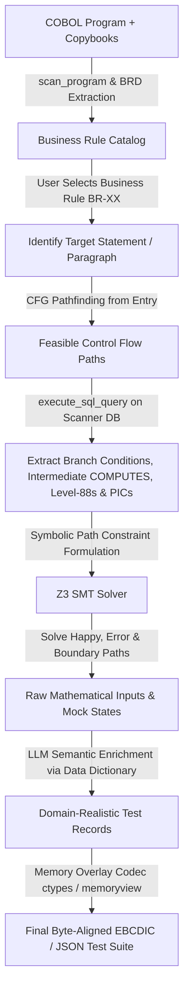

# Synthetic Mainframe Test Data Generation Architecture

An automated, mathematically rigorous, and business-rule-driven pipeline for generating synthetic test datasets tailored to selected COBOL functionalities, with full branch coverage, edge cases, and coordinated external dependency mocking.

---

## 1. High-Level Pipeline Overview



---

## 2. End-to-End Workflow Stages

### Stage 1: Business Rule Cataloging (BRD Extraction)
1. **Application Scan**: Run `scan_program` on the workspace to populate the metadata database.
2. **Rule Extraction**: Automatically extract and catalog business rules from program logic (decision trees, `EVALUATE`, `IF-THEN-ELSE` blocks, and copybook definitions).
3. **Interactive Selection**: Present the user with a structured catalog of business rules (e.g., `BR-01: Tiered Interest Calculation`, `BR-02: Overdraft Authorization`).
4. **Target Binding**: Once the user selects a rule, map it directly to the corresponding target paragraph(s) and statement range in the CFG.

### Stage 2: CFG Pathfinding & Symbolic Slicing
1. **Control Flow Graph Traversal**: Trace all feasible execution paths starting from program `ENTRY` down to the target rule's code block.
2. **SQL AST & Dependency Querying**: Use `execute_sql_query` to extract:
   - Branch predicates (`IF`, `EVALUATE`, `WHEN`, Level-88 condition names).
   - Assignment / transformation expressions (`MOVE`, `COMPUTE`, `ADD`).
   - Variable declarations (PIC clauses, binary types, `COMP-3`, `OCCURS`, `REDEFINES`).
   - External dependency points (`EXEC SQL`, `READ/WRITE VSAM`, `EXEC CICS LINK`, `CALL`, `MQGET`).
3. **Symbolic Back-Substitution**: Express intermediate calculated variables in terms of root input variables and external dependency responses so that inputs naturally steer program execution from `ENTRY` to the target.

### Stage 3: Z3 SMT Constraint Solving across Scenarios
The pipeline constructs and solves path constraints across three distinct categories:

1. **Happy Path Generation**:
   - Solves for typical, valid input variables and successful dependency return codes (`SQLCODE = 0`, `FILE STATUS = '00'`, `EIBRESP = NORMAL`) that satisfy all gatekeeper conditions leading to the successful rule outcome.
2. **Error / Exception Path Generation**:
   - Systematically negates individual branch conditions and injects external failure states (`SQLCODE = +100` Not Found, `-911` Deadlock, `FILE STATUS = '23'` Key Not Found, `EIBRESP = PGMIDERR`, `RETURN-CODE >= 8`) to test error handling, rollback, and abend logic.
3. **Boundary Condition Generation**:
   - Identifies comparison points ($A \text{ op } B$) and solves for exact boundary values:
     - On-boundary: $A = B$
     - Boundary minus one: $A = B - \epsilon$
     - Boundary plus one: $A = B + \epsilon$
     - Type extremes: Minimum / Maximum allowable PIC values, `HIGH-VALUES`, `LOW-VALUES`, `ZEROES`, `SPACES`.

### Stage 4: Coordinated External Dependency Mocking
External dependencies are not mocked in isolation—their values are co-generated with the input record to guarantee end-to-end path consistency:
- **DB2 SQL**: Mock table rows, cursor result sets, and host variable outputs bound to input primary keys.
- **VSAM Datasets**: Mock record layouts matching index keys and file status codes.
- **CICS Commareas / Channels**: Input/Output container buffers and execution response codes.
- **Subprograms**: Parameter values and return codes for `CALL ... USING`.
- **IBM MQ**: Message descriptors (MQMD), correlation IDs, and message bodies.

### Stage 5: Semantic Enrichment & Data Dictionary Alignment
1. **Realistic Value Mapping**: The LLM replaces raw dummy mathematical values from Z3 (e.g., `"AAAAAA"`, `99999`) with contextual, domain-accurate entities (names, valid dates, addresses, routing numbers) without violating Z3's mathematical inequality constraints.
2. **Data Dictionary Validation**: Validates all generated values against the central Data Dictionary (`DD.json`) and semantic business schemas.

### Stage 6: Binary Memory Layout & Codec Packing
1. **Memoryview Overlay Generation**: Automatically compiles Python `ctypes.Structure` / `memoryview` descriptors matching the COBOL copybook layouts.
2. **Encoding & Alignment**:
   - Converts text strings to IBM EBCDIC (Cp1047 / Cp037).
   - Packs zoned decimals (`DISPLAY`) and packed decimals (`COMP-3` / `COMP-4` / `COMP-5`).
   - Handles byte alignment, slack bytes, and overlapping `REDEFINES` buffers.

---

## 3. Test Suite Artifact Directory Structure

For each selected Business Rule, the pipeline outputs a self-contained, automated test package:

```text
generated_tests/
└── BR-04_Tiered_Risk_Assessment/
    ├── manifest.json                  # Traceability metadata, rule definition, CFG path summary
    ├── 01_happy_path.json             # Valid inputs reaching successful rule completion
    ├── 02_error_paths.json            # Error branch inputs and dependency failure scenarios
    ├── 03_boundary_conditions.json    # Exact boundary and edge-value test records
    └── mocks/
        ├── sql_mock_data.json         # Mock DB2 table rows and SQLCODEs
        ├── vsam_mock_records.bin      # Binary/EBCDIC mock VSAM records
        ├── cics_commarea_mocks.json   # Mock CICS COMMAREA / Container payloads
        └── subprogram_mocks.json      # Mock parameters for external CALLs
```

---

## 4. Manifest & Scenario Schema Examples

### `manifest.json`
```json
{
  "rule_id": "BR-04",
  "rule_name": "Tiered Risk Assessment",
  "source_program": "LNVAL01.cbl",
  "target_paragraphs": ["3000-EVALUATE-RISK", "3100-TIER-ASSIGN"],
  "cfg_depth": 14,
  "scenarios_generated": {
    "happy_paths": 2,
    "error_paths": 5,
    "boundary_conditions": 8
  },
  "dependencies_mocked": ["DB2:CUST_TABLE", "VSAM:ACCTMAST", "CALL:CRDTSUB"]
}
```

### `01_happy_path.json`
```json
{
  "scenario_id": "HAPPY_PATH_01",
  "rule_id": "BR-04",
  "description": "Standard approved applicant with high credit score and zero overdrafts",
  "program_inputs": {
    "IN_CUSTOMER_ID": "CUST89210",
    "IN_LOAN_AMOUNT": 25000.00,
    "IN_LOAN_TERM_MONTHS": 36
  },
  "external_mocks": {
    "db2_queries": [
      {
        "statement": "SELECT CREDIT_SCORE, CUST_TIER FROM CUST_TABLE WHERE CUST_ID = :IN-CUSTOMER-ID",
        "mock_response": {
          "SQLCODE": 0,
          "CREDIT_SCORE": 780,
          "CUST_TIER": "GOLD"
        }
      }
    ],
    "vsam_reads": [
      {
        "file": "ACCTMAST",
        "key": "CUST89210",
        "mock_response": {
          "FILE_STATUS": "00",
          "RECORD": { "OVERDRAFT_COUNT": 0, "YEARS_WITH_BANK": 5 }
        }
      }
    ]
  },
  "expected_outcome": {
    "BRANCH_TAKEN": "3100-TIER-ASSIGN",
    "WS_APPROVAL_STATUS": "APPROVED",
    "WS_ASSIGNED_RATE": 0.0350
  }
}
```
